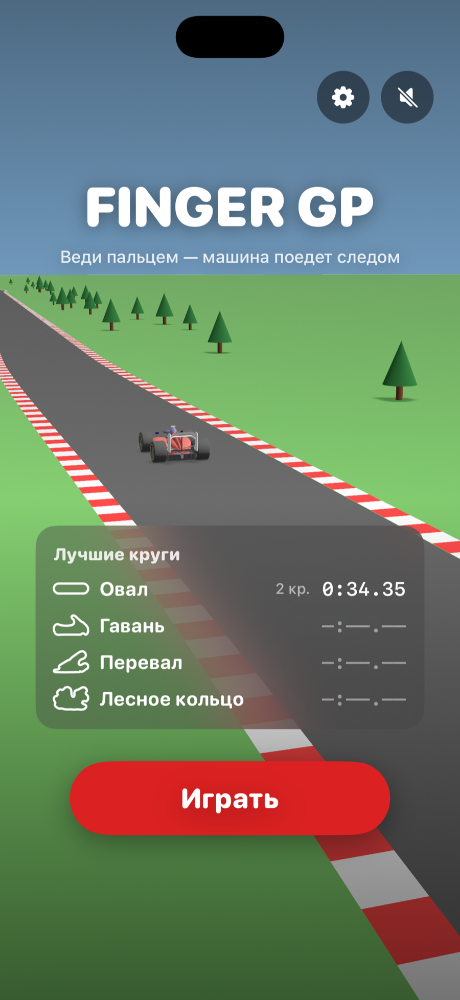
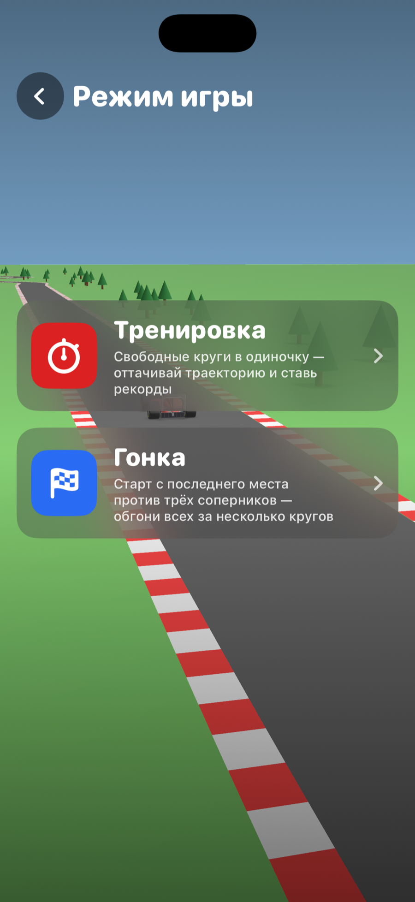
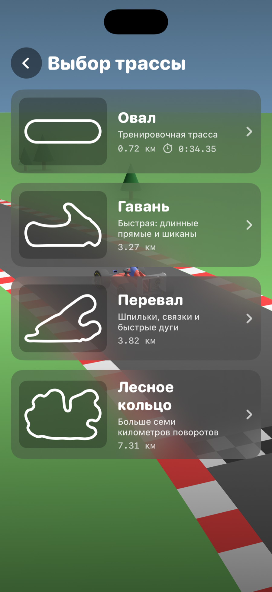
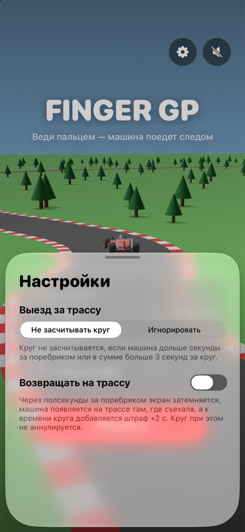
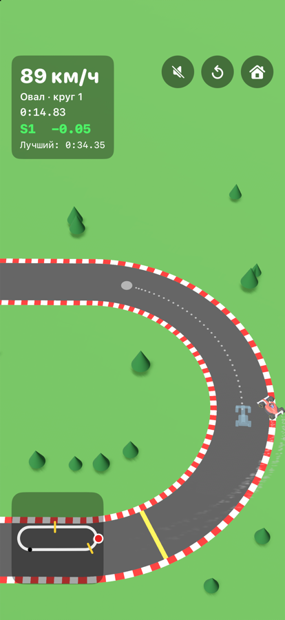
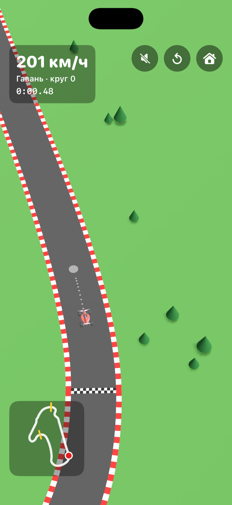
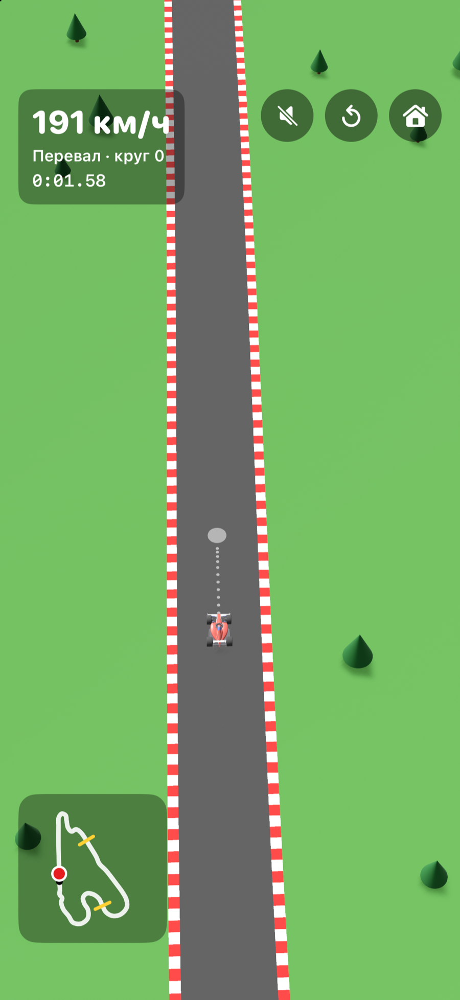
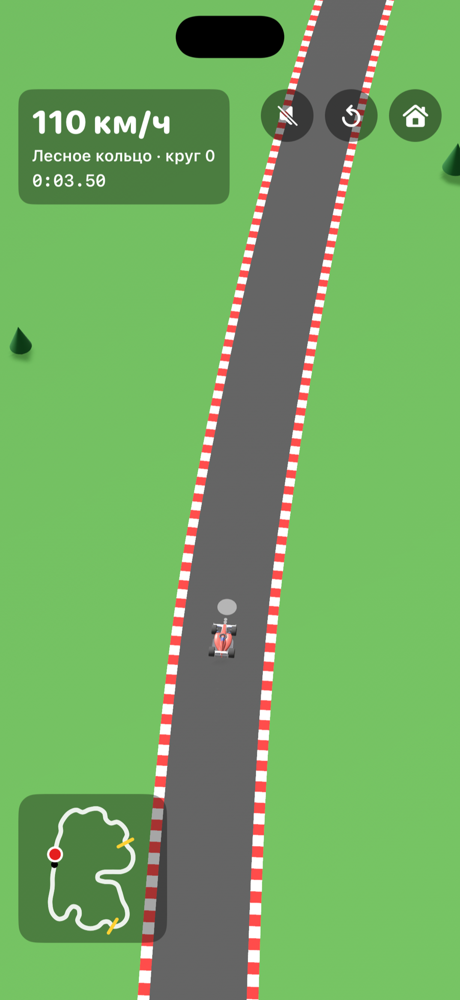
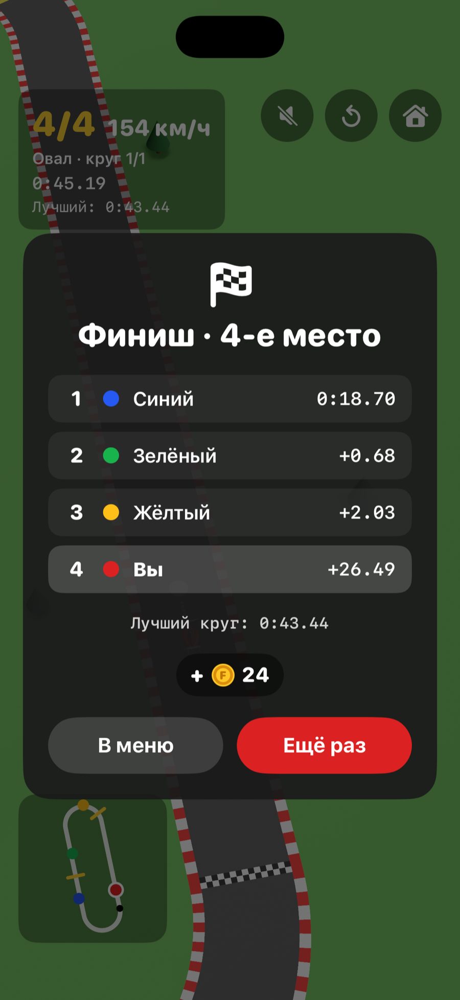
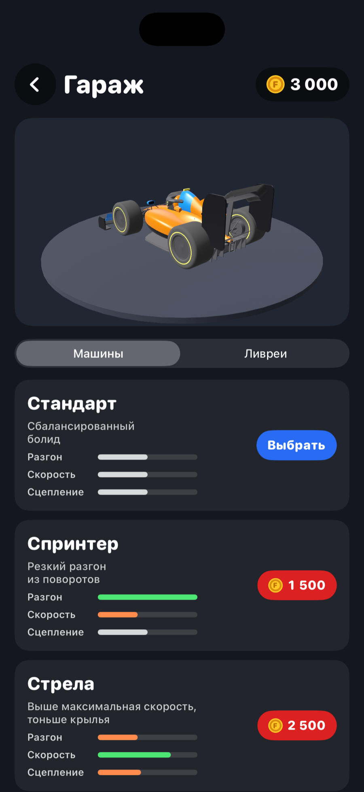

# Finger GP

Аркадная гонка для iPhone, где машиной управляют пальцем: проводишь линию по трассе — болид едет следом.
Чем быстрее ведёшь палец, тем быстрее едет машина; палец остановился — машина доезжает нарисованную
траекторию и тормозит.

  
  
  
  

  
  
  
  

  
  

## Что есть в игре

- **Управление пальцем.** Линия сглаживается от дрожания руки, машина едет по ней с небольшой задержкой.
- **Простая физика.** Максимум 350 км/ч, ограниченное сцепление: в резкий поворот на полной скорости
  не войти — машину сносит и она теряет скорость. Трава тормозит, поребрики — нет.
- **Четыре трассы:** тренировочный Овал, быстрая «Гавань», техничный «Перевал» и «Лесное кольцо» (7 км).
- **Камера,** которая смотрит на участок трассы впереди и поворачивается вместе с ним, и мини-карта.
- **Честный зачёт круга:** три сектора с отсечками по порядку; срезка по траве (вылет дольше 1 с или в сумме
  больше 3 с за круг) — круг не засчитывается.
- **Настройки выезда за трассу** (шестерёнка в меню): не засчитывать круг или игнорировать выезды;
  опционально — возвращать машину на трассу (затемнение на секунду; круг не засчитывается, а при «Игнорировать» — штраф +2 с).
- **Старт с хода** (включён по умолчанию, отключается в настройках): машина сама разгоняется к линии старта
  до ~180 км/ч, три красных огня гаснут по очереди, примерно за 3 с до линии загорается зелёный — касание забирает
  управление (не перехватил — машина отпускается, когда гаснут зелёные огни), и первый круг идёт на скорости.
- Подсказка «Веди пальцем…» показывается только в первых трёх гонках.
- Если машина стоит больше 1,5 с, появляется анимированная рука: касается трассы впереди машины и ведёт по ней
  (с вибрацией — щелчок на касании, непрерывная на ведении).
- **Время по секторам:** на каждой отсечке и на финише — разница с лучшим кругом («−0.32» зелёным, «+0.15» красным).
  Отсечки отмечены жёлтыми полосами на трассе и штрихами на мини-карте.
- **Призрак лучшего круга:** полупрозрачная машина и точка на мини-карте повторяют рекорд трассы.
- **Режим «Тренировка»** со статистикой: лучший круг и число кругов по каждой трассе сохраняются.
- **Три режима:** «Тренировка» — свободные круги, свой призрак и своё время; «Испытание» — медали; «Гонка».
- **Медали в «Испытании»:** бронза, серебро и золото за время круга на каждой трассе. Медальные времена ставит
  автопилот с той же физикой (считается при запуске), его круг — призрак-цель в цвете следующей медали,
  время по секторам — против него.
  «Перевал» открывается за 2 очка медалей, «Лесное кольцо» — за 5 (бронза 1, серебро 2, золото 3).
- **Монеты и гараж:** монеты за побитый рекорд в тренировке (25), новые медали (50/100/200, один раз)
  и места в гонке (150/110/80/55/35/20 с поправкой на длину трассы, первая победа — ещё 100). В гараже за монеты —
  машины с другими характеристиками и крыльями («Спринтер», «Стрела», «Цепкий») и ливреи.
- **Пауза:** кнопка в правом верхнем углу; игра встаёт на паузу и сама, если её свернуть или пришёл звонок.
- **Режим «Гонка»:** старт с места с последнего места решётки против пяти соперников (синий, фиолетовый, зелёный, голубой, жёлтый),
  несколько кругов (Овал — 5, «Лесное кольцо» — 2, остальные — 3). Соперники едут с той же физикой по профилю
  скорости трассы и обгоняют; в HUD — место и круг; слипстрим за машиной
  впереди на скорости от 180 км/ч и без заноса (прибавка скорости и струи воздуха). Столкновения — по желанию в настройках. Лучшее место — кубок в меню.
- **Звук и вибрация:** синтезированный мотор, рокот поребриков, сигналы круга и рекорда, лаунж-мелодия в меню; вибрация на поребриках, траве и рекорде.
- **Эффекты:** дым из-под колёс в резких поворотах, выхлоп, подсказка «не то направление».
- **Меню** с «дроновыми» пролётами над трассами на фоне.

## Запуск

Нужны Xcode 16+ и iOS 18+.

1. Откройте `RaceGame.xcodeproj`.
2. Выберите симулятор или iPhone и нажмите Run. Для запуска на своём телефоне укажите в Signing & Capabilities
   свою команду (подойдёт бесплатная Personal Team) и уникальный Bundle Identifier.

Отладочные аргументы запуска (Edit Scheme → Arguments). Работают только в отладочной сборке (`App/DebugFlags.swift`),
как и настройка «Показывать FPS»:

| Аргумент | Что делает |
|---|---|
| `-autopilot` | демо-палец сам ведёт машину по трассе (по умолчанию «Гавань») |
| `-race`, `-challenge` | открыть трассу в режиме «Гонка» или «Испытание» (вместе с `-track` или `-autopilot`) |
| `-laps N` | гонка на N кругов (для проверки финиша) |
| `-unlockAll` | открыть все трассы без медалей |
| `-coins N` | задать баланс монет |
| `-screen garage` | открыть сразу гараж |
| `-track oval\|harbor\|pass\|forest` | сразу открыть гонку на этой трассе (и для `-autopilot`) |
| `-reverse` | демо-палец едет против хода трассы |
| `-wobble` | демо-палец «дрожит» — проверка сглаживания линии |
| `-screen mode\|select\|settings` | открыть сразу выбор режима, трассы или настройки |
| `-drift` | демо-палец раз за круг уводит машину на траву (проверка выездов) |
| `-settings.resetToTrack YES`, `-settings.offTrackRule ignore`, `-settings.rollingStart NO` | изменить настройки без меню |
| `-resetRecords` | сбросить рекорд, сектора и призрак открываемой трассы |
| `-sound.muted YES` | запустить без звука |

## Устройство проекта

Код разложен по слоям: игровая логика не зависит от экранов, экраны собраны из переиспользуемых компонентов.

| Папка | Что внутри |
|---|---|
| `App/` | точка входа и навигация между экранами |
| `Game/Core/` | игровая сцена: `GameController` (состояние, кадр) и его расширения по темам — ввод, камера, старт и автопилот, круги и призраки, гонка, возврат на трассу, эффекты, передача данных в HUD; `GameState` — данные для HUD |
| `Game/Car/` | `CarFollower` — «машина едет за пальцем» с физикой, `CarEntity` — 3D-модель, ливрея, эффекты; `GhostCar` — призрак |
| `Game/Track/` | `Track` — геометрия трассы, `Track+Centerline` — построение осевой, `Track+Scene` — 3D-сцена; каталог трасс |
| `Game/Track/Scenery/` | Декорации: деревья, арка над стартом, рекламные щиты, логотипы у поворотов, таблички торможения. Всё склеивается в общие меши (`SceneryBuilder`). Рекламные места — `AdSlot`, их содержимое отдаёт `AdContent` (сейчас — вымышленные бренды-заглушки) |
| `Game/Race/` | `LapTimer` — зачёт круга и сектора; `RaceSession` — гонка (соперники, позиции, итоги) с расширениями «вождение» и «контакт»; `AutoDriver` — профиль скорости и виртуальный палец |
| `Progress/` | рекорды и призраки, медали, кошелёк, машины, ливреи, награды |
| `Settings/` | настройки игры |
| `Audio/`, `Haptics/` | синтез звука и музыки, вибрация |
| `UI/Theme.swift` | цвета и стиль «стеклянной» панели |
| `UI/Components/` | переиспользуемые элементы: кнопки (`CapsuleButton`, `CircleButton`, `PurchaseButton`), шапка экрана, карточки режима и трассы, переключатель настройки, баннер, монеты, медали, ливрея, полоска характеристики |
| `UI/Screens/` | экраны: меню, выбор режима и трассы, настройки, гараж, гонка, итоги |
| `UI/HUD/` | HUD гонки: панель, мини-карта, стартовые огни, подсказка жестом, FPS |
| `race_car_package/` | исходники 3D-модели болида и её документация |
| `tools/make_icon.swift` | генерация иконки приложения |
