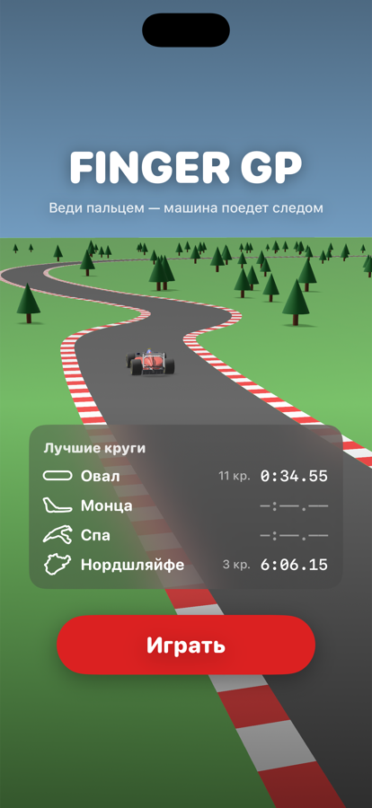
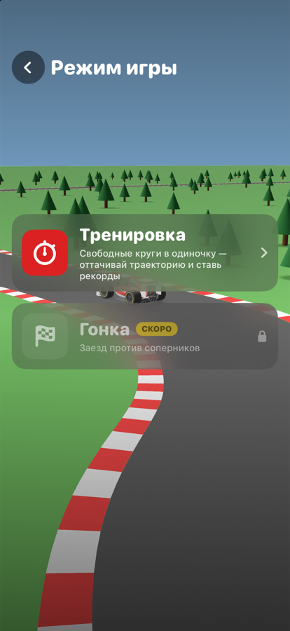
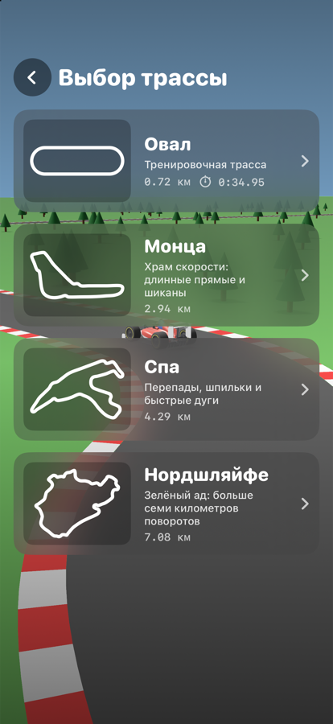
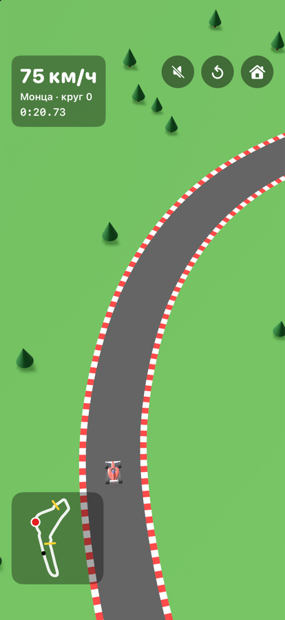
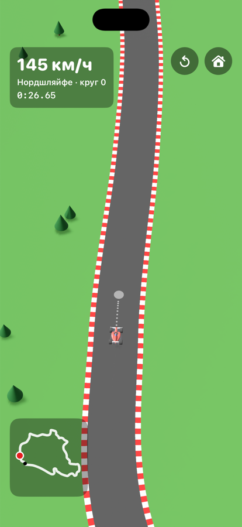
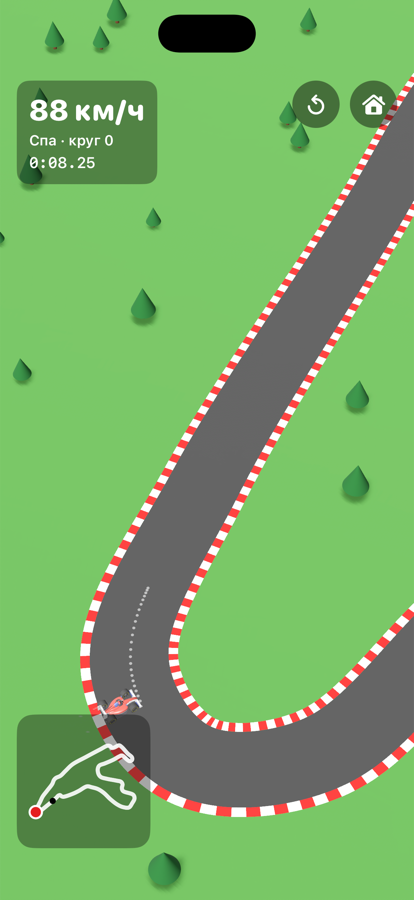

# Finger GP

Аркадная гонка для iPhone, где машиной управляют пальцем: проводишь линию по трассе — болид едет следом.
Чем быстрее ведёшь палец, тем быстрее едет машина; палец остановился — машина доезжает нарисованную
траекторию и тормозит.

  
  
  

  
  
  

## Что есть в игре

- **Управление пальцем.** Линия сглаживается от дрожания руки, машина едет по ней с небольшой задержкой.
- **Простая физика.** Максимум 350 км/ч, ограниченное сцепление: в резкий поворот на полной скорости
  не войти — машину сносит и она теряет скорость. Трава тормозит, поребрики — нет.
- **Четыре трассы:** тренировочный Овал, Монца, Спа и Нордшляйфе (7 км).
- **Камера,** которая смотрит на участок трассы впереди и поворачивается вместе с ним, и мини-карта.
- **Честный зачёт круга:** три сектора с отсечками по порядку; срезка по траве (вылет дольше 1 с или в сумме
  больше 3 с за круг) — круг не засчитывается.
- **Настройки выезда за трассу** (шестерёнка в меню): не засчитывать круг или игнорировать выезды;
  опционально — возвращать машину на трассу (затемнение на секунду, штраф +2 с к кругу).
- **Время по секторам:** на каждой отсечке и на финише — разница с лучшим кругом («−0.32» зелёным, «+0.15» красным).
- **Призрак лучшего круга:** полупрозрачная машина и точка на мини-карте повторяют рекорд трассы.
- **Режим «Тренировка»** со статистикой: лучший круг и число кругов по каждой трассе сохраняются.
  Режим «Гонка» — в планах.
- **Звук и вибрация:** синтезированный мотор, рокот поребриков, сигналы круга и рекорда, лаунж-мелодия в меню; вибрация на поребриках, траве и рекорде.
- **Эффекты:** дым из-под колёс в резких поворотах, выхлоп, подсказка «не то направление».
- **Меню** с «дроновыми» пролётами над трассами на фоне.

## Запуск

Нужны Xcode 16+ и iOS 18+.

1. Откройте `RaceGame.xcodeproj`.
2. Выберите симулятор или iPhone и нажмите Run. Для запуска на своём телефоне укажите в Signing & Capabilities
   свою команду (подойдёт бесплатная Personal Team) и уникальный Bundle Identifier.

Отладочные аргументы запуска (Edit Scheme → Arguments):

| Аргумент | Что делает |
|---|---|
| `-autopilot` | демо-палец сам ведёт машину по трассе (по умолчанию Монца) |
| `-track oval\|monza\|spa\|nordschleife` | трасса для `-autopilot` |
| `-reverse` | демо-палец едет против хода трассы |
| `-wobble` | демо-палец «дрожит» — проверка сглаживания линии |
| `-screen mode\|select` | открыть сразу выбор режима или трассы |
| `-drift` | демо-палец раз за круг уводит машину на траву (проверка выездов) |
| `-settings.resetToTrack YES`, `-settings.offTrackRule ignore` | включить настройки выезда без меню |
| `-resetRecords` | сбросить рекорд, сектора и призрак открываемой трассы |
| `-sound.muted YES` | запустить без звука |

## Устройство проекта

| Файл | Что внутри |
|---|---|
| `RaceGame/RaceGameApp.swift` | экраны SwiftUI: меню, выбор режима и трассы, HUD, мини-карта |
| `RaceGame/GameView.swift` | игровая сцена RealityKit: ввод, камера, круги, эффекты |
| `RaceGame/Car.swift` | модель машины и логика «машина едет за пальцем» с физикой |
| `RaceGame/Track.swift` | построение трассы: осевая линия, асфальт, поребрики, деревья |
| `RaceGame/TrackCatalog.swift` | описания трасс (опорные точки со схем) |
| `RaceGame/FlyoverView.swift` | фон меню с пролётами над трассами |
| `RaceGame/RaceSettings.swift` | настройки гонки (правила выезда за трассу) |
| `RaceGame/LapTimer.swift` | хронометраж, сектора и честный зачёт круга |
| `RaceGame/LapRecords.swift` | рекорды, сектора и запись призрака лучшего круга |
| `RaceGame/RaceAudio.swift` | синтез звука в реальном времени: мотор, шины, поребрики, сигналы |
| `RaceGame/RaceHaptics.swift` | вибрация |
| `RaceGame/MenuMusic.swift` | фоновая мелодия меню (синтез) |
| `race_car_package/` | исходники 3D-модели болида и её документация |
| `tools/make_icon.swift` | генерация иконки приложения |
